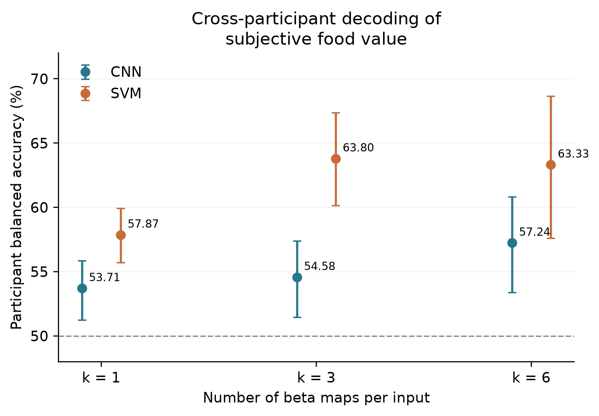
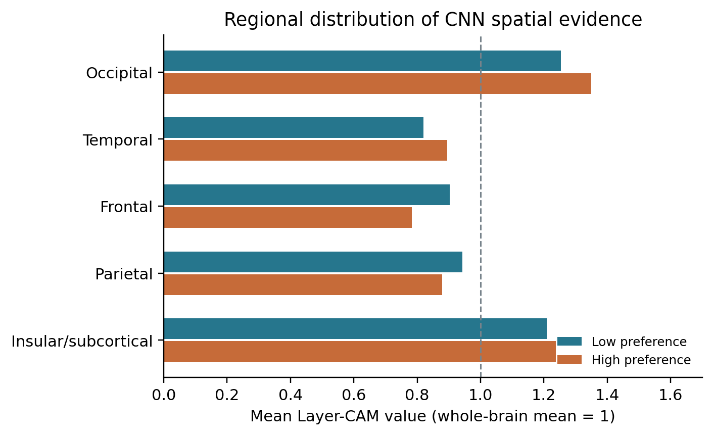

# Reproduce result figures

Use the included results to redraw the decoding and Layer-CAM charts. See [decoding results](results.md) for the task, evaluation protocol, and reported performance.

## Generate the figures

From the repository root, use Python 3.11 or newer:

```bash
python -m venv .venv
source .venv/bin/activate
python -m pip install -e .
python scripts/reproduce_figures.py
```

Figures are saved as PNG and vector PDF in `outputs/figures/`. The command reads the included predictions and regional data, recomputes the chart values, and uses the saved bootstrap confidence intervals. It runs on CPU with the base project dependencies.

To choose an output directory:

```bash
python scripts/reproduce_figures.py --output-dir outputs/paper_figures
```

## Result charts

Each basename below is produced as both `.png` and `.pdf`. Ready-to-use copies are in [figures/reproduced](../figures/reproduced/).

| Figure basename | Contents |
|---|---|
| `decoding_performance` | Participant-average balanced accuracy for CNN and linear SVM at k = 1, 3, and 6; error bars show participant-bootstrap 95% confidence intervals. |
| `layercam_macroregions` | Mean Layer-CAM values for the five regional groups in low- and high-value predictions. |
| `layercam_selected_rois` | Low- and high-value Layer-CAM values for selected anatomical ROIs. |
| `layercam_top5_rating1` | Five highest-valued ROIs per regional group for low-value predictions. |
| `layercam_top5_rating4` | Five highest-valued ROIs per regional group for high-value predictions. |

The Layer-CAM figures use the k = 6 CNN. Values are normalized to the whole-brain mean of each category's group map, with a reference value of 1. Regional-group means weight ROI values by voxel count.





## Brain maps and diagrams

The original figure PDFs are available directly:

| Figure | File |
|---|---|
| GLM and Searchlight brain maps | [neuro_results.pdf](../figures/original/neuro_results.pdf) |
| Low- and high-value Layer-CAM brain maps | [layercam.pdf](../figures/original/layercam.pdf) |
| Task sequence | [task.pdf](../figures/original/task.pdf) |
| CNN architecture | [cnn_architecture.pdf](../figures/original/cnn_architecture.pdf) |

These PDFs provide the existing surface renderings and diagrams; the plotting command above redraws the statistical charts.

## Export the underlying tables

```bash
python scripts/reproduce_results.py
```

Tables are written to `outputs/reproduced/tables/`. The main chart inputs are `decoding_performance.csv`, `decoding_participants.csv`, `layercam_macroregions.csv`, `layercam_all_rois.csv`, and `layercam_top5_rois.csv`.
